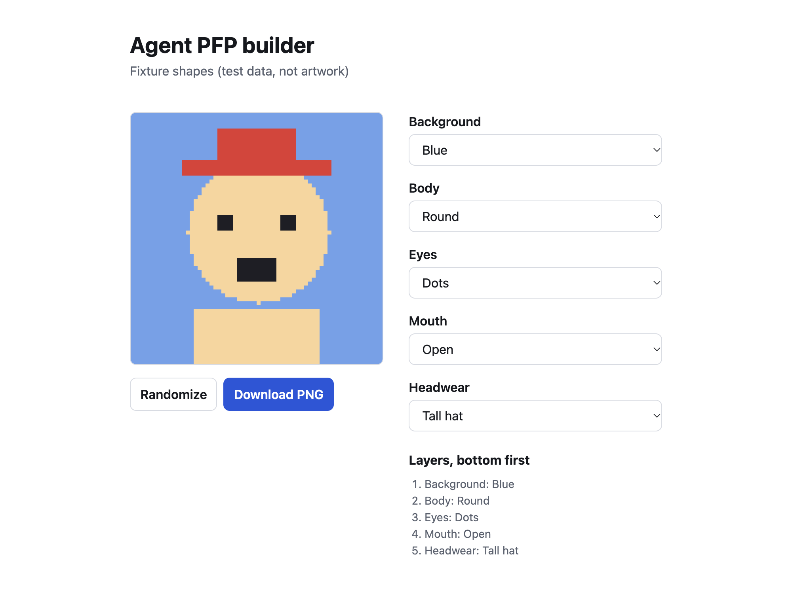

# Agent PFP

Agent PFP is a builder for coding-agent profile pictures. You pick an art style, choose one layer in each trait group (body, eyes, headwear and so on), hit randomize if you want a surprise, and download the picture.

Each style is a fixed set of layers prepared ahead of time. The app does not generate images.

I'm building it during the [Qodo Software Factory Hackathon](https://hackathon.qodo.ai/). Coding agents write the code and Qodo reviews each pull request before I merge it.



The picture in the screenshot is made from test shapes.

## What works today

- A manifest format that describes one style: the canvas size, the trait groups in draw order and the options in each group. It is documented in [docs/manifest.md](docs/manifest.md).
- `validateManifest` in [src/manifest.js](src/manifest.js), which checks a manifest and lists what is wrong with it.
- `compositeLayers` in [src/composite.js](src/composite.js), which draws the layers of a selection into one picture.
- A render check that fails a style when a layer is the wrong size, blank, cut off by a canvas edge, outside its zone or overlapping another group, or when a finished picture has a hole. It is documented in [docs/render-check.md](docs/render-check.md).
- A builder page with a Style picker. It loads the style's manifest, shows one picker per group, previews the picture and downloads it as a PNG. A Size picker on the line above Download offers Full size, which is the style's canvas, and GitHub (500 x 500), which is the finished picture scaled down. A style whose canvas isn't square or is smaller than 500 px offers Full size only. The file is named `agent-pfp-<style id>.png`, or `agent-pfp-<style id>-500.png` for the GitHub size. The sizes are decided in [src/download.js](src/download.js) and the scaling is in [src/scale.js](src/scale.js).
- A style index, [styles/index.json](styles/index.json), that lists the styles the builder offers. It is documented in [docs/styles.md](docs/styles.md).

No artwork is in this repository yet. The files under `fixtures/` are plain shapes used as test data.

## Run it

You need Node 22 or newer.

```sh
npm ci
npm test         # unit tests
npm run check    # render check on each style in styles/index.json
npm start        # builder page at http://127.0.0.1:4173/web/
```

To check another style, pass its manifest: `node bin/render-check.js path/to/manifest.json`.

To look at a style that isn't in this repository yet, start the server with the folder that holds its style folder: `npm start -- --styles ../my-styles`. The Style picker lists it with "(local)" after its name. [docs/styles.md](docs/styles.md) has the details.

## Layout

| Path | What it holds |
| --- | --- |
| `src/` | Code shared by the builder page and the command line tools |
| `web/` | The builder page |
| `bin/` | Command line tools |
| `styles/` | The style index the builder reads |
| `fixtures/` | Test data: manifests and plain-shape layers |
| `factory/` | The runner that starts the coding agent on a ticket with the `ready-for-agent` label, see [docs/factory.md](docs/factory.md) |
| `docs/` | Format and runner documentation |
| `test/` | Unit tests, run with `node --test` |
| `AGENTS.md` | Setup, checks and house rules for the coding agents and reviewers |
